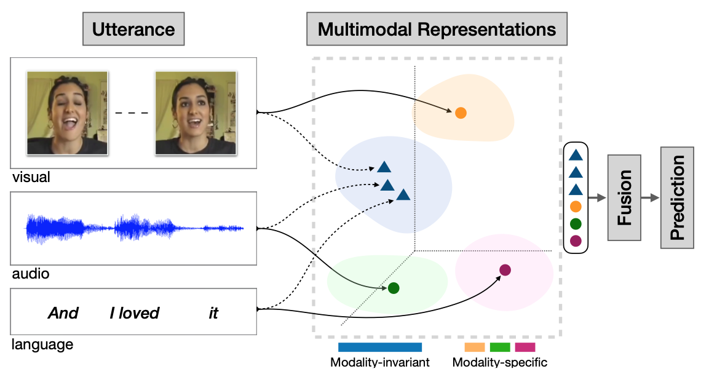

# MISA: Modality-Invariant and -Specific Representations for Multimodal Sentiment Analysis
Code for the [ACM MM 2020](https://2020.acmmm.org) paper [MISA: Modality-Invariant and -Specific Representations for Multimodal Sentiment Analysis](https://arxiv.org/pdf/2005.03545.pdf)


<p align="center">
  
</p>


### Setup the environment

We work with a conda environment.

```
conda env create -f environment.yml
conda activate misa-code
```

### Data Download

- Install [CMU Multimodal SDK](https://github.com/A2Zadeh/CMU-MultimodalSDK). Ensure, you can perform ```from mmsdk import mmdatasdk```.    
- Option 1: Download [pre-computed splits](https://drive.google.com/drive/folders/1IBwWNH0XjPnZWaAlP1U2tIJH6Rb3noMI?usp=sharing) and place the contents inside ```datasets``` folder.     
- Option 2: Re-create splits by downloading data from MMSDK. For this, simply run the code as detailed next.

### Running the code

1. ```cd src```
2. Set ```word_emb_path``` in ```config.py``` to [glove file](http://nlp.stanford.edu/data/glove.840B.300d.zip).
3. Set ```sdk_dir``` to the path of CMU-MultimodalSDK.
2. ```python train.py --data mosi```. Replace ```mosi``` with ```mosei``` or ```ur_funny``` for other datasets.

### Shared Alignment Loss (extension)

The shared (modality-invariant) branch can be aligned with one of two losses, selected via `--shared_align_loss`:

| Argument | Values | Default | Description |
|----------|--------|---------|-------------|
| `--shared_align_loss` | `cmd`, `atp` | `cmd` | Shared alignment loss. `cmd` is the original MISA Central Moment Discrepancy; `atp` aligns unit-normalized shared representations. |
| `--atp_variant` | `text`, `all` | `all` | ATP variant: `text` anchors audio/video to text; `all` aligns all three pairs. |
| `--sim_weight` | float | `1.0` | Weight of the selected shared alignment loss. |
| `--cu_weight` | non-negative float | `0.0` | Sample-centroid uniformity weight. Zero disables CU and preserves existing versions. |
| `--cu_tau` | positive float | `2.0` | Distance scale in the uniformity exponential. |

**ATP** (`--shared_align_loss atp`) minimizes the mean squared distance between unit-normalized shared representations. The `--atp_variant` switch selects the alignment target:

- `text` — anchors audio and video to text, aligning only the text-audio and text-video pairs.
- `all` (default) — symmetrically aligns all three pairs (text-audio, text-video, audio-video), averaged with equal weight.

Notes:

- `atp` requires `--use_cmd_sim true` (the default); combining ATP with `--use_cmd_sim false` raises a configuration error. Domain-adversarial alignment remains available with `--shared_align_loss cmd --use_cmd_sim false`.
- The task loss, DiffLoss, reconstruction, model structure and prediction path are unchanged. CU is optional and can also be used with CMD for an independent control.

### ATP-all + centroid uniformity (CU)

For each sample, normalize the three shared representations, average them with
equal weights, then normalize the resulting centroid:

```text
z_m = normalize(h_shared_m), for m in {text, audio, video}
u_i = normalize((z_text_i + z_audio_i + z_video_i) / 3)
L_ATP-all = mean_i (||z_text_i-z_audio_i||² + ||z_text_i-z_video_i||²
                   + ||z_audio_i-z_video_i||²) / 3
L_CU = log(mean_{i<j} exp(-cu_tau * ||u_i-u_j||²))
L_total = L_task + diff_weight * L_diff + sim_weight * L_alignment
          + recon_weight * L_recon + cu_weight * L_CU
```

CU excludes self-pairs and uses a stable log-sum-exp calculation. Gradients flow
through the centroid into all three modalities; the normalization does not
modify the states used by fusion, reconstruction or DiffLoss. A batch with fewer
than two total samples has zero CU loss. With `torchrun`, centroids are gathered
across ranks with autograd, so CU uses the global batch; its backward scaling
accounts for the solver's existing parameter-gradient averaging. No extra
division by the number of GPUs is needed. The existing distributed sampler can
pad an epoch with repeated examples, which remain in the sampled global batch.

CU is normally non-positive: a lower total training loss alone is not evidence
of better prediction. Logs report task, alignment, reconstruction, DiffLoss and
CU separately, plus centroid cosine/variance diagnostics (averaged across
batches). Validation/test `eval_loss` remains task loss only. Shared Sigmoid
outputs still restrict normalized centroids to the positive region of the sphere.

From `src`, select each version explicitly. Distinct names keep checkpoints
separate (choose a new name when repeating a run):

```bash
# Original MISA / CMD
python train.py --data mosi --seed 336 --shared_align_loss cmd --cu_weight 0 --name mosi_cmd_s336

# Earlier text-anchored ATP
python train.py --data mosi --seed 336 --shared_align_loss atp --atp_variant text --cu_weight 0 --name mosi_atp_text_s336

# ATP-all, without CU
python train.py --data mosi --seed 336 --shared_align_loss atp --atp_variant all --cu_weight 0 --name mosi_atp_all_s336

# ATP-all + CU (0.01 is a starting weight, not a tuned optimum)
python train.py --data mosi --seed 336 --shared_align_loss atp --atp_variant all --cu_weight 0.01 --cu_tau 2 --name mosi_atp_all_cu001_s336

# Same new variant on four GPUs
torchrun --standalone --nproc_per_node=4 train.py --data mosi --seed 336 --shared_align_loss atp --atp_variant all --cu_weight 0.01 --cu_tau 2 --name mosi_atp_all_cu001_4gpu_s336
```

The default remains CMD with CU disabled; the existing ATP variant default
remains `all`. For a validation-only CU weight search, compare `0`, `0.01`,
`0.05`, and `0.1` with the same seeds and training setup, then evaluate the
selected setting on the test set. Checkpoints are stored in the repository's
`checkpoints/` directory.

Loss and distributed-gradient checks (CPU, no dataset/model download), from
the repository root:

```bash
python -m unittest discover -s tests -v
```

### Citation

If this paper is useful for your research, please cite us at:

```
@article{hazarika2020misa,
  title={MISA: Modality-Invariant and-Specific Representations for Multimodal Sentiment Analysis},
  author={Hazarika, Devamanyu and Zimmermann, Roger and Poria, Soujanya},
  journal={arXiv preprint arXiv:2005.03545},
  year={2020}
}
```

### Contact

For any questions, please email at [hazarika@comp.nus.edu.sg](mailto:hazarika@comp.nus.edu.sg)
