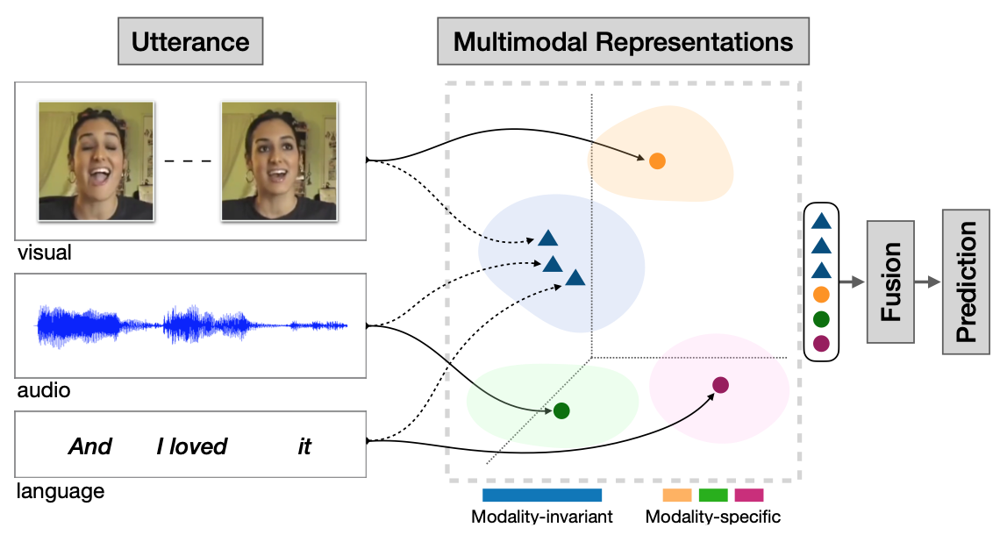

## MISA-HL：分布预测头（候选对照版本）

`misa_hl` = **MISA with Histogram-Loss head**。这是便于实验的版本名，不是已确认的
论文方法名，也不代表效果或首创性。它**只替换最后的单值预测头**，保留 MISA 的
共享／私有表示、六 token Transformer 融合、重构与 DiffLoss，默认仍是 CMD、
SP=PP=0.3，且不叠加 ATP/CU/KL/RNC。旧的标量版本与命令完全不变。

```text
文本/音频/视频 → 共享/私有表示 → 六表示 Transformer 融合 → 预测头
  标量：Linear(hidden*3, 1)                    → 单值回归，MSE
  分布：Linear(hidden*3, K) → softmax → 期望   → 连续分数，交叉熵
```

- 融合主干到 `fusion_layer_1 → dropout → activation` 的 `hidden*3` 特征保持不变，
  分布头是一层 `Linear(hidden*3, K)`。分布模式**只使用并训练这个新头**：旧的标量
  `fusion_layer_3` 仍被构造以保证不同预测头下骨干初始化/RNG 一致，但被冻结、
  不参与前向与优化器。主实验**从零训练**，不做标量 checkpoint 迁移。
- 输出 `K` 个有序分数位置 logits，`p = softmax(logits)`；连续预测为
  `ŷ = Σ_k p_k c_k`，`c_k` 为分数位置。默认 `K=21`、位置 `-3.0 … 3.0`（步长 0.3）。
- 目标分布使用 HL-Gauss 软标签：以真实标签为中心的 N(0, σ²) 落入各区间边界的
  概率质量，再对每行归一化。边界由相邻位置中点给出并向两端各扩半个步长，
  因此 `-3` 和 `3` 附近的高斯被截断、软标签期望会略向中间偏移；请单独检查极端
  标签误差。`hl_sigma`（默认 0.3）是**输出分数分布宽度**，与衡量样本间标签邻域的
  `sent_sigma` 是两个不同参数。
- 训练损失默认用分布交叉熵替代原任务 MSE：
  `L = L_HL + diff + sim*L_CMD + recon*L_recon`。`--hl_reg_weight` 可加一项
  `λ|ŷ-y|`；默认 0 表示纯交叉熵，是否混合需单独对照。
- 验证时先把分布转成连续值，再算整份验证集 **MAE**；分布版按 **MAE** 选模，
  标量版仍按 MSE。这是两套协议，比较时不要混用选模规则。

```bash
# 独立对照：分布头（默认 CMD，从零训练）
python src/train.py --data mosei --variant misa_hl --seed 336
# 或显式开关（可在任意 CMD 版本上单独启用/关闭）
python src/train.py --data mosei --prediction_head distribution --hl_sigma 0.15 --seed 336
```

参数：`--prediction_head scalar|distribution`、`--hl_bins`、`--hl_min/--hl_max`、
`--hl_sigma`、`--hl_reg_weight`。评估自动从 `config_<name>.json` 读回预测头类型与分布参数：

```bash
python src/evaluate.py --name <运行名>
```

注意事项：

- 分布期望被限制在 `[hl_min, hl_max]`，而原标量头无此限制；若分布版有效，建议补一个
  “有界标量头＋MSE”对照，区分收益是否部分来自输出范围约束。
- 分布模式的 checkpoint 与标量 checkpoint 结构不同（新增 `hl_projection`），不能
  严格互载；主实验从零训练。旧的标量层虽保留但在分布模式下不参与训练，迁移不是
  本版本的支持路径。
- 训练集标签若超出 `[hl_min, hl_max]`，首轮会打印越界计数，软标签被压到边缘；
  MOSEI/MOSI 情感标签通常在 `[-3,3]`，正式训练前仍应核对实际缓存范围。
- 该版本尚未运行完整数据训练；不据实现或单元测试宣称效果。

测试：`python -m unittest discover -s tests -p 'test_hl_head.py' -v`。

## MISA-SCPS-v2：门控优化与固定样本诊断

`--variant misa_scps_v2` 默认只改变以下训练设置，结构与损失同 SCPS：

| 设置 | misa_scps | misa_scps_v2 |
| --- | --- | --- |
| 门控末层权重 std | 0.001 | 0.01 |
| selector 学习率倍率 | 1 | 3 |
| 初始门控目标 | 0.9 | 0.9 |
| 固定验证 batch / 梯度诊断 | 默认关闭 | 默认开启 |

新增模块的参数组包括上下文 C、三个门控和其 LayerNorm；其余可训练参数在原学习率
组，不重复计入。冻结规则不变，调度器对两组同倍率衰减。允许显式覆盖
`--scps_init_std` / `--gate_lr_mult` / `--scps_diagnostics true|false`。

项目根目录训练（同样可使用 torchrun，默认只由 rank 0 写诊断）：

```bash
python src/train.py --data mosei --variant misa_scps_v2 --seed 336
```

建议使用同一种子做四组，其他训练参数一致；旧版打开诊断不改变其初始化/学习率：

```bash
python src/train.py --data mosei --variant misa_scps --scps_diagnostics true --seed 336
python src/train.py --data mosei --variant misa_scps --scps_init_std 0.01 --scps_diagnostics true --seed 336
python src/train.py --data mosei --variant misa_scps --gate_lr_mult 3 --scps_diagnostics true --seed 336
python src/train.py --data mosei --variant misa_scps_v2 --seed 336
```

默认运行名带时间避免覆盖；同时保留 config_<name>.json，评估仍为
`python src/evaluate.py --name <运行名>`。V2 没有新增权重张量维度，SCPS 与 V2 的
同结构模型权重兼容，但两组优化器状态不能当作旧单组状态续训；主实验从头训练。
V2 无门控消融需同时 `--private_selection none --scps_diagnostics false`。

在 checkpoint 目录保存：

- `scps_fixed_dev_<name>.pt`：缓存的第一个验证 batch（含标签），固定排序，供复查。
- `scps_diagnostics_<name>.jsonl`：第 0 轮（训练前）及每轮末的诊断。

诊断每轮 eval/no_grad，恢复随机数和模型模式，不进行反向传播、不参与选模；
不读取测试集。固定 batch 通常很小，仅定位机制，不代表整个验证集表现。
门控统计包含 mean、相对第 0 轮同一样本的 mean/max_abs_change、偏离 0.9 的均值、
逐维跨样本 sample_std；预测记录学得门控与固定 0.9 的 MAE 和逐样本预测差值。
训练记录 context、每模态前层/末层/LayerNorm 的平均梯度 L2 范数（多卡梯度归约后、
裁剪前）、有梯度/非零梯度步数，以及从本轮开始到本轮结束的参数绝对/相对更新。
第 0 轮没有训练梯度，相关字段为零。门控变化包含输入表示变化，不能代替参数更新。
每轮诊断针对该轮末权重，而非事后恢复的最佳 checkpoint。
重复使用已有诊断运行名会拒绝覆盖，请选择新 --name。

测试入口：`python -m unittest discover -s tests -p 'test_scps_v2.py' -v`。
尚未验证完整数据性能，不把门控变化增大视为模型效果提升。

## MISA-SCPS：共享上下文条件化的私有选择（方案 B）

`misa_scps` = **Shared-Context-conditioned Private Selection**。第一版用于检验融合前
私有特征筛选的机制，是候选研究版本，不代表已经验证的新颖性或收益。

- 一个上下文网络：`c = ReLU(Linear(concat(s_t,s_a,s_v).detach()))`，3d→d。
- 三个独立门控：`g_m = sigmoid(Linear(ReLU(Linear(concat(LayerNorm(p_m),c)))))`，
  2d→64→d；`selected_p_m = g_m * p_m`。不做模态间 softmax。
- 门控输入归一化不改变原始私有表示；每个门控末层小随机权重、bias=logit(0.9)，
  初始接近放行且第一步上下文网络即可获得梯度，没有预设文本优势。
- 仅共享上下文输入 detach，C 本身可训练，共享分支仍通过原融合路径更新。
- 六个 token 仍按原来的 `p_t,p_v,p_a,s_t,s_v,s_a` 顺序，只替换前三个为筛选表示。
- 重构、CMD、DiffLoss 均使用原始表示；无新增损失。默认 SP=PP=0.3，保留原 MISA
  损失，预设拒绝 ATP/CU/KL/RNC 和不等权的 PDR 组合。

从项目根目录从头训练：

```bash
python src/train.py --data mosei --variant misa_scps --seed 336
# 多卡（与原基线保持相同 GPU 数和训练设置）
torchrun --standalone --nproc_per_node=4 src/train.py --data mosei --variant misa_scps --seed 336
```

将 mosei 换成 mosi 切换数据集。默认自动运行名包含数据集/版本/种子/时间，显式
`--name` 仍可使用。`--scps_hidden 64` 与 `--scps_init_gate 0.9` 可调。
日志中的每模态 gate mean / sample std 是训练期间逐 batch 均值，多卡为各 rank
本地诊断，不是全数据固定模型统计，也不是模态因果贡献。

消融（都不引入新损失）：

```bash
# 无门控，同原始骨干，无新增参数
python src/train.py --data mosei --variant misa_scps --private_selection none --seed 336
# 只看私有表示，无共享上下文网络；输入宽度不同，不是精确等参数对照
python src/train.py --data mosei --variant misa_scps --private_selection private_only --seed 336
```

最佳 checkpoint 旁的 `config_<name>.json` 保存架构与损失配置。评估自动读回配置：

```bash
python src/evaluate.py --name <训练日志中的运行名>
```

请一起保留/传输 model 与 config 文件。显式评估参数与保存配置冲突会报错，避免
错误重建架构。旧无 config 的模型仍按原默认架构评估；无 config 的默认 SCPS
权重可显式加 `--data mosei --variant misa_scps`（非默认架构需保留原配置）。
SCPS 增加参数，不能严格加载旧 MISA 权重，也不支持自动忽略缺失参数。
`private_probe_v2` 会优先读回 checkpoint 旁的 `config_<name>.json` 重建架构，因此
同一入口可探针 CMD/PDR/SCPS 权重；若缺 config 则退回固定 CMD 默认，非默认架构会因
严格加载失败而报错。

验证：`python -m unittest discover -s tests -p 'test_private_selection.py' -v`。
此版本尚未运行完整数据训练；不据门控数值或测试通过宣称效果。

## MISA-PDR：私有去相关约束放松（方案 A）

`misa_pdr` = **MISA Private Decorrelation Relaxation**。这是研究实验版本名，
不是已经验证有效的新算法。使用 CMD，保留重构和六表示 Transformer 融合；
仅拆分 DiffLoss 的共享/私有（SP）和私有/私有（PP）权重。

```text
L_SP = D(p_t,s_t) + D(p_v,s_v) + D(p_a,s_a)
L_PP = D(p_a,p_t) + D(p_a,p_v) + D(p_t,p_v)
L = L_task + diff_sp_weight*L_SP + diff_pp_weight*L_PP
    + sim_weight*L_CMD + recon_weight*L_recon
```

两部分都是三对的和，不额外除以 3。两个新权重是绝对系数，不再额外乘 diff_weight。

| --variant | SP 默认权重 | PP 默认权重 | 用途 |
| --- | --- | --- | --- |
| default | diff_weight（默认 0.3） | diff_weight（默认 0.3） | 原始对照；旧命令保持原损失 |
| misa_pdr | diff_weight | diff_weight/3（默认 0.1） | 方案 A，减弱 PP |
| misa_pdr_zero | diff_weight | 0 | 方案 A，关闭 PP |

显式 `--diff_sp_weight` / `--diff_pp_weight` 优先于默认值。例如基线的 diff_weight
为 0.6 时，misa_pdr 自动用 0.6/0.2；也可以分别指定两个绝对权重。
预设拒绝 ATP、域对抗和正权重 CU/KL/RNC，避免混杂；额外组合需显式选 default。

从头训练（项目根目录执行；将 mosei 改为 mosi 即可切换数据集）：

```bash
python src/train.py --data mosei --variant misa_pdr --seed 336
python src/train.py --data mosei --variant misa_pdr_zero --seed 336
python src/train.py --data mosei --variant default --seed 336
```

未指定 `--name` 时自动生成含数据集、版本、种子和时间的运行名；显式 name 仍受支持。
多卡示例：

```bash
torchrun --standalone --nproc_per_node=4 src/train.py --data mosei --variant misa_pdr --seed 336
```

日志打印解析后的 SP/PP 绝对权重、未加权 DiffLoss 和实际加权贡献；最佳 checkpoint
旁新增 `config_<name>.json` 记录配置，模型权重格式不变。评估仍用原入口：

```bash
python src/evaluate.py --data mosei --name <训练日志中的运行名> --shared_align_loss cmd
```

保持与原 CMD 实验相同的其他参数、数据和配对种子（建议 336–340）。可先做三个种子
检查趋势，再补齐五个；验证集选模，测试集不用于调参。PDR-zero 只关闭 PP 损失，
私有编码器依旧从任务、SP 和重构接收梯度。训练完成后可复用私有探针诊断新表示。

验证：`python -m unittest discover -s tests -p 'test_pdr.py' -v`。
尚未运行完整 MOSI/MOSEI 训练，不能从代码验证推断实际性能收益。

# MISA: Modality-Invariant and -Specific Representations for Multimodal Sentiment Analysis
Code for the [ACM MM 2020](https://2020.acmmm.org) paper [MISA: Modality-Invariant and -Specific Representations for Multimodal Sentiment Analysis](https://arxiv.org/pdf/2005.03545.pdf)

Research context for this fork: [研究方案与当前状态](RESEARCH_CONTEXT.md). AI assistants should first read [AGENTS.md](AGENTS.md).

### 冻结特征私有信息诊断：`private_probe_v2`

独立入口 `src/probe_private.py`（逻辑在 `src/probe_utils.py`），冻结已有模型，
缓存融合前的六个原始 Sigmoid 表示，再用**统一结构 + 固定输入掩码**训练五组小预测头。
只读取已有的 train/dev 数据缓存，不读取 test.pkl、不重建数据、不调用原 Solver 的
训练或测试流程。原模型、主训练目标及默认配置保持不变。

模型使用 `eval()` 且全部参数冻结；一次前向提取 `utt_shared_{t,a,v}` 与
`utt_private_{t,a,v}`。共享输入始终拼接三个共享表示，不取质心，也不套用 ATP 的
单位归一化——诊断的是模型实际学到的表示。

五组使用**同一输入布局** `[s_t, s_a, s_v, p_t, p_a, p_v]`（宽 `6d`）和**固定掩码**：

| 组名 | 掩码 | 含义 |
| --- | --- | --- |
| `shared` | `[1,1,1,0,0,0]` | 只有共享信息（基线） |
| `shared_pt` | `[1,1,1,1,0,0]` | 加文本私有 |
| `shared_pa` | `[1,1,1,0,1,0]` | 加音频私有 |
| `shared_pv` | `[1,1,1,0,0,1]` | 加视觉私有 |
| `shared_all` | `[1,1,1,1,1,1]` | 加全部私有 |

掩码在训练和验证期间一致，避免"训练时全输入、测试时突然置零"的输入变化。
标准化只在**训练特征**上拟合均值/方差，再应用到验证集；顺序是先标准化、再套掩码。
五组共用同一个小 MLP：`Linear(6d, 64) → ReLU → Linear(64, 1)`，相同初始化种子、
样本打乱顺序、优化器和训练预算，每组独立训练。掩码维度的参数不接收梯度，因此
**参数总量相同但有效容量不完全相等**，不能声称五组等价为同一函数类。

固定预测头种子 `11,22,33`；Adam、学习率 `1e-3`、weight decay=0、batch size=64、
最多 100 轮，验证 MSE 连续 10 轮未改善即停止，恢复验证 MSE 最低的预测头。
训练损失为 MSE，验证误差按全部样本计算，不平均不同大小 batch 的均值。

从仓库根目录运行（先准备 state_dict 和项目原有数据/BERT 环境）：

```bash
python src/probe_private.py \
  --data mosei \
  --checkpoint checkpoints/model_mosei_cmd_s336.std \
  --groups shared shared_pt shared_pa shared_pv shared_all \
  --probe_seeds 11 22 33 \
  --output_dir results/private_probe/mosei_cmd_s336
```

`--device auto` 默认有 CUDA 则使用 CUDA，否则 CPU；可指定 `--device cpu/cuda`。
单进程运行，不用 torchrun。`--extract_batch_size`（默认 64）控制提取显存占用。
不传 `--output_dir` 则创建带时间戳的新目录；已有目录会报错，防止覆盖结果。

**架构读取：** 若 `model_<name>.std` 旁存在训练保存的 `config_<name>.json`，则读回
`use_bert/use_cmd_sim/shared_align_loss/atp_variant/hidden_size/rnncell/dropout/
variant/private_selection/scps_*/activation` 等架构字段（manifest 记录
`architecture_source`）；否则退回固定 CMD 默认（BERT、hidden_size=128、LSTM、ReLU）。
因此同一入口可连 CMD/PDR/SCPS 等 checkpoint，但需严格匹配原训练架构；state_dict
不含历史损失来源，仍需自行核对训练记录。

数据必须已存在于 `datasets/MOSI/` 或 `datasets/MOSEI/`：`train.pkl`、`dev.pkl`、
`embedding_and_mapping.pt`。诊断读取沿用原始预处理和 collate，同时保存经过排序的
样本 ID，保证特征、标签、预测一一对应。数据缓存须为可信的项目文件。

输出包括：

- `manifest.json`：固定协议、模型配置、标准化方式、checkpoint/数据/特征缓存 SHA-256、状态。
- `features.pt`：train/dev 六组特征、标签、样本 ID 和提取元数据；同一次运行的所有
  预测头复用该缓存，不自动复用历史缓存。
- `per_seed.csv`、`summary.csv`、`summary.json`：逐种子结果、均值及样本标准差。
- 每组每种子的 `.pt` 最佳预测头、`_history.json` 训练曲线和 `_dev_predictions.csv`。

`delta_mae_vs_shared = MAE(shared) - MAE(当前组)`，按相同种子配对，正值表示改善；
`delta_corr_vs_shared` 为加入私有后的 Corr 减去 shared 的 Corr。
MAE/MSE/Corr 使用全部验证样本；`acc3` 对预测与标签截断到 [−3,3] 后取整；
`acc2_nonzero`/`f1_nonzero` 排除标签 0 并用 `>0` 二分；`acc2_with_zero`/`f1_with_zero`
保留标签 0 并用 `>=0` 二分；F1 为真实标签在前的 weighted F1。常数预测/标签导致
相关系数未定义或无有效样本时记 JSON null / CSV 空白，不能当作 0 分。

这是固定编码器上的探索性验证集诊断：衡量在固定预测头与训练条件下，加入私有特征
是否提高验证集预测能力。它**不能**证明私有特征的信息论独立性或原融合模块的因果贡献，
也不代表原模型编码器的稳定性。验证集参与早停，结果不构成独立测试结论；若写成正式
结论，须固定方案后另做独立测试集评估。

离线测试（无真实数据或 BERT 下载，开发验证环境为 PyTorch 2.4.1）：

```bash
python -m unittest discover -s tests -p 'test_private_probe.py' -v
```


<p align="center">
  
</p>


### Setup the environment

We work with a conda environment.

```
conda env create -f environment.yml
conda activate misa-code
```

### Data Download

- Install [CMU Multimodal SDK](https://github.com/A2Zadeh/CMU-MultimodalSDK). Ensure, you can perform ```from mmsdk import mmdatasdk```.    
- Option 1: Download [pre-computed splits](https://drive.google.com/drive/folders/1IBwWNH0XjPnZWaAlP1U2tIJH6Rb3noMI?usp=sharing) and place the contents inside ```datasets``` folder.     
- Option 2: Re-create splits by downloading data from MMSDK. For this, simply run the code as detailed next.

### Running the code

1. ```cd src```
2. Set ```word_emb_path``` in ```config.py``` to [glove file](http://nlp.stanford.edu/data/glove.840B.300d.zip).
3. Set ```sdk_dir``` to the path of CMU-MultimodalSDK.
2. ```python train.py --data mosi```. Replace ```mosi``` with ```mosei``` or ```ur_funny``` for other datasets.

### Shared Alignment Loss (extension)

The shared (modality-invariant) branch can be aligned with one of two losses, selected via `--shared_align_loss`:

| Argument | Values | Default | Description |
|----------|--------|---------|-------------|
| `--shared_align_loss` | `cmd`, `atp` | `cmd` | Shared alignment loss. `cmd` is the original MISA Central Moment Discrepancy; `atp` aligns unit-normalized shared representations. |
| `--atp_variant` | `text`, `all` | `all` | ATP variant: `text` anchors audio/video to text; `all` aligns all three pairs. |
| `--sim_weight` | float | `1.0` | Weight of the selected shared alignment loss. |
| `--cu_weight` | non-negative float | `0.0` | Sample-centroid uniformity weight. Zero disables CU and preserves existing versions. |
| `--cu_tau` | positive float | `2.0` | Distance scale in the uniformity exponential. |
| `--sent_weight` | non-negative float | `0.0` | Sentiment-conditioned centroid KL weight; exclusive with positive `cu_weight` or `rnc_weight`. |
| `--sent_sigma` | positive float | `1.0` | Continuous-label neighborhood width (in the original label units). |
| `--sent_tau` | positive float | `1.0` | Representation neighborhood temperature; divides squared centroid distance. |

**ATP** (`--shared_align_loss atp`) minimizes the mean squared distance between unit-normalized shared representations. The `--atp_variant` switch selects the alignment target:

- `text` — anchors audio and video to text, aligning only the text-audio and text-video pairs.
- `all` (default) — symmetrically aligns all three pairs (text-audio, text-video, audio-video), averaged with equal weight.

Notes:

- `atp` requires `--use_cmd_sim true` (the default); combining ATP with `--use_cmd_sim false` raises a configuration error. Domain-adversarial alignment remains available with `--shared_align_loss cmd --use_cmd_sim false`.
- The task loss, DiffLoss, reconstruction, model structure and prediction path are unchanged. CU is optional and can also be used with CMD for an independent control.

### ATP-all + centroid uniformity (CU)

For each sample, normalize the three shared representations, average them with
equal weights, then normalize the resulting centroid:

```text
z_m = normalize(h_shared_m), for m in {text, audio, video}
u_i = normalize((z_text_i + z_audio_i + z_video_i) / 3)
L_ATP-all = mean_i (||z_text_i-z_audio_i||² + ||z_text_i-z_video_i||²
                   + ||z_audio_i-z_video_i||²) / 3
L_CU = log(mean_{i<j} exp(-cu_tau * ||u_i-u_j||²))
L_total = L_task + diff_weight * L_diff + sim_weight * L_alignment
          + recon_weight * L_recon + cu_weight * L_CU
```

CU excludes self-pairs and uses a stable log-sum-exp calculation. Gradients flow
through the centroid into all three modalities; the normalization does not
modify the states used by fusion, reconstruction or DiffLoss. A batch with fewer
than two total samples has zero CU loss. With `torchrun`, centroids are gathered
across ranks with autograd, so CU uses the global batch; its backward scaling
accounts for the solver's existing parameter-gradient averaging. No extra
division by the number of GPUs is needed. The existing distributed sampler can
pad an epoch with repeated examples, which remain in the sampled global batch.

CU is normally non-positive: a lower total training loss alone is not evidence
of better prediction. Logs report task, alignment, reconstruction, DiffLoss and
CU separately, plus centroid cosine/variance diagnostics (averaged across
batches). Validation/test `eval_loss` remains task loss only. Shared Sigmoid
outputs still restrict normalized centroids to the positive region of the sphere.

From `src`, select each version explicitly. Distinct names keep checkpoints
separate (choose a new name when repeating a run):

```bash
# Original MISA / CMD
python train.py --data mosi --seed 336 --shared_align_loss cmd --cu_weight 0 --name mosi_cmd_s336

# Earlier text-anchored ATP
python train.py --data mosi --seed 336 --shared_align_loss atp --atp_variant text --cu_weight 0 --name mosi_atp_text_s336

# ATP-all, without CU
python train.py --data mosi --seed 336 --shared_align_loss atp --atp_variant all --cu_weight 0 --name mosi_atp_all_s336

# ATP-all + CU (0.01 is a starting weight, not a tuned optimum)
python train.py --data mosi --seed 336 --shared_align_loss atp --atp_variant all --cu_weight 0.01 --cu_tau 2 --name mosi_atp_all_cu001_s336

# Same new variant on four GPUs
torchrun --standalone --nproc_per_node=4 train.py --data mosi --seed 336 --shared_align_loss atp --atp_variant all --cu_weight 0.01 --cu_tau 2 --name mosi_atp_all_cu001_4gpu_s336
```

The default remains CMD with CU disabled; the existing ATP variant default
remains `all`. For a validation-only CU weight search, compare `0`, `0.01`,
`0.05`, and `0.1` with the same seeds and training setup, then evaluate the
selected setting on the test set. Checkpoints are stored in the repository's
`checkpoints/` directory.

Loss and distributed-gradient checks (CPU, no dataset/model download), from
the repository root:

```bash
python -m unittest discover -s tests -v
```

### ATP-all + sentiment-conditioned centroid relations

This variant replaces CU with the research plan's label-conditioned neighborhood
KL loss, while retaining the existing MISA six-representation Transformer fusion,
task loss, DiffLoss and reconstruction. It does **not** implement the document's
separate centroid-plus-private fusion architecture. No model parameters or
checkpoint tensor shapes are added or changed.

```text
z_m_i = normalize(h_shared_m_i)
c_i = (z_text_i + z_audio_i + z_video_i) / 3  # NO second normalization
q_ij = exp(-abs(y_i-y_j)/sent_sigma) / sum_{k!=i} exp(-abs(y_i-y_k)/sent_sigma)
p_ij = exp(-||c_i-c_j||²/sent_tau) / sum_{k!=i} exp(-||c_i-c_k||²/sent_tau)
L_sent = mean_i sum_{j!=i} q_ij * (log(q_ij) - log(p_ij))
L_total = L_task + diff_weight * L_diff + sim_weight * L_alignment
          + recon_weight * L_recon + sent_weight * L_sent
```

Both distributions exclude self-pairs and normalize over each row's neighbors.
The implementation removes the diagonal before log-softmax to avoid undefined
diagonal KL terms. It sums KL over neighbors and averages over samples, not over
all pair entries. A global batch of fewer than three samples has zero loss:
with two samples each row has just one neighbor and both distributions are `[1]`.

Use real continuous MOSI/MOSEI training labels, without rounding, binning or
rescaling. Labels are detached targets; gradients flow through all three shared
branches. Under `torchrun`, centroids and labels are gathered together in matching
rank/sample order, with centroid gradients preserved and the existing distributed
gradient averaging respected. The sampler's padding behavior described above
also applies here. No labels enter model inference; dev/test prediction and
`eval_loss` remain unchanged. This loss is disabled for UR_FUNNY classification.

Old CU retains its unit-length centroid and its original exponential multiplier
`cu_tau`. The new `sent_tau` is a **divisor** and is not interchangeable with
`cu_tau`. Comparing these variants changes both the neighborhood objective and
the final centroid normalization; a separate controlled normalization ablation
is needed to attribute improvements to the objective alone.

Enable exactly one sample-level constraint through its weight:

| Version | Flags in addition to `--shared_align_loss atp --atp_variant all` |
|---------|----------------------------------------------------------------|
| ATP-all only | `--cu_weight 0 --sent_weight 0` |
| ATP-all + original CU | `--cu_weight 0.01 --sent_weight 0 --cu_tau 2` |
| ATP-all + sentiment relations | `--cu_weight 0 --sent_weight 0.01 --sent_sigma 1 --sent_tau 1` |

At most one of CU, sentiment KL, and RNC weights may be positive; conflicting weights raise a configuration error. Existing
CMD/ATP/CU commands continue to work because `sent_weight` defaults to zero.
The example weight and temperatures below are starting settings, not validated
optima; select them using validation data, keeping the label scale fixed.

From `src`:

```bash
# New variant on one GPU (or CPU)
python train.py --data mosi --seed 336 --shared_align_loss atp --atp_variant all --sim_weight 1 --cu_weight 0 --sent_weight 0.01 --sent_sigma 1 --sent_tau 1 --name mosi_atp_all_sent001_sigma1_tau1_s336

# New variant on four GPUs
torchrun --standalone --nproc_per_node=4 train.py --data mosi --seed 336 --shared_align_loss atp --atp_variant all --sim_weight 1 --cu_weight 0 --sent_weight 0.01 --sent_sigma 1 --sent_tau 1 --name mosi_atp_all_sent001_sigma1_tau1_4gpu_s336
```

For MOSEI, change `--data mosi` to `--data mosei` and use a distinct `--name`.
Training logs show the raw and weighted sentiment KL, nearest-centroid neighbor's
mean absolute label gap, raw centroid variance and mean centroid norm. These are
global-training-batch diagnostics averaged across steps, not held-out quality
estimates. Lower KL alone does not prove prediction improvement or rule out
collapse; compare validation task metrics and representation statistics.

### Citation

If this paper is useful for your research, please cite us at:

```
@article{hazarika2020misa,
  title={MISA: Modality-Invariant and-Specific Representations for Multimodal Sentiment Analysis},
  author={Hazarika, Devamanyu and Zimmermann, Roger and Poria, Soujanya},
  journal={arXiv preprint arXiv:2005.03545},
  year={2020}
}
```

### Contact

For any questions, please email at [hazarika@comp.nus.edu.sg](mailto:hazarika@comp.nus.edu.sg)

### ATP-all + Rank-N-Contrast (RNC)

This independent control replaces the **sample-level** CU/KL term with RNC,
while retaining ATP-all, task supervision, DiffLoss, reconstruction and the
six-representation Transformer fusion. It adds no model parameters.

This is a **single-view centroid adaptation of the RNC loss**, not a reproduction
of the original augmented two-view / representation-pretraining pipeline.
Reference: [Rank-N-Contrast, NeurIPS 2023](https://arxiv.org/abs/2210.01189)
and [official loss implementation](https://github.com/kaiwenzha/Rank-N-Contrast/blob/main/loss.py).
No duplicate features are manufactured as a second view.

```text
c_i = (normalize(shared_t_i) + normalize(shared_a_i) + normalize(shared_v_i)) / 3
# NO second normalization; same centroid as the sentiment KL variant.
dy_ij = abs(y_i - y_j)
s_ij = -||c_i-c_j||_2          # rnc_distance=l2 (official metric)
s_ij = -||c_i-c_j||_2^2        # rnc_distance=l2sq (controlled variant)
S_ij = {k != i : dy_ik >= dy_ij}
L_RNC = mean_{i,j!=i} [logsumexp_{k in S_ij}(s_ik/rnc_tau) - s_ij/rnc_tau]
L_total = L_task + diff_weight * L_diff + recon_weight * L_recon
          + sim_weight * L_ATP-all + rnc_weight * L_RNC
```

The candidate itself and all equally distant label neighbors remain in the
denominator. Self-pairs are excluded. The mean is over `N*(N-1)` ordered pairs.
A global batch with fewer than three samples returns a differentiable zero.
All-equal labels do not generally imply zero RNC: if off-diagonal feature
distances are also equal, the loss is `log(N-1)` for `N >= 3`.

| Argument | Default | Description |
| --- | --- | --- |
| `--rnc_weight` | `0.0` | Non-negative finite loss weight; zero disables RNC. |
| `--rnc_tau` | `2.0` | Positive finite temperature dividing feature distance. |
| `--rnc_distance` | `l2` | `l2` for the official Euclidean metric; `l2sq` for squared distance, matching the KL metric. |

At most one of `cu_weight`, `sent_weight`, `rnc_weight` may be positive.
This first version intentionally excludes RNC+KL joint training. RNC uses raw
continuous MOSI/MOSEI training labels and is rejected for UR_FUNNY. Existing
commands remain compatible because `rnc_weight` defaults to zero.

Like sentiment KL, RNC uses differentiably gathered **global-batch** centroids
and correspondingly ordered detached labels under `torchrun`. The loss needs no
extra `world_size` division with the solver's parameter-gradient averaging.
Existing distributed-sampler padding still applies. Neither RNC nor labels are
added to inference; dev/test loss and model selection remain task-based.

Implementation sorts label gaps per row, computes suffix `logcumsumexp`, and
uses the first index of each tie group to obtain exact denominators. It avoids
an `N x N x N` mask and uses quadratic pairwise storage. Logs identify the
metric/temperature/weight and report raw/weighted RNC, nearest-neighbor label
gap, centroid variance and centroid norm (diagnostics averaged across batches).

From `src`, using distinct names for each run:

```bash
# ATP-all without sample-level relations
python train.py --data mosi --seed 336 --shared_align_loss atp --atp_variant all --cu_weight 0 --sent_weight 0 --rnc_weight 0 --name mosi_atp_all_only_s336

# Independent RNC control: official Euclidean distance
python train.py --data mosi --seed 336 --shared_align_loss atp --atp_variant all --sim_weight 1 --cu_weight 0 --sent_weight 0 --rnc_weight 0.01 --rnc_tau 2 --rnc_distance l2 --name mosi_atp_all_rnc_l2_s336

# Squared-distance control for comparison with sentiment KL
python train.py --data mosi --seed 336 --shared_align_loss atp --atp_variant all --sim_weight 1 --cu_weight 0 --sent_weight 0 --rnc_weight 0.01 --rnc_tau 2 --rnc_distance l2sq --name mosi_atp_all_rnc_l2sq_s336

# Same RNC version on four GPUs
torchrun --standalone --nproc_per_node=4 train.py --data mosi --seed 336 --shared_align_loss atp --atp_variant all --sim_weight 1 --cu_weight 0 --sent_weight 0 --rnc_weight 0.01 --rnc_tau 2 --rnc_distance l2 --name mosi_atp_all_rnc_l2_4gpu_s336
```

The example weight and temperature are starting settings, not tuned results.
Give RNC and KL comparable validation tuning budgets; equal numerical weights
or temperatures do not imply equal constraint strength. Keep representation,
normalization, seeds, effective batch size and evaluation protocol fixed.

Run `python -m unittest discover -s tests -v` from the repository root to check
formula values and gradients against an explicit reference, label-distance ties,
permutation invariance, both distances, degenerate batches, existing routes,
real solver training/evaluation with a tiny model, and two-process CPU Gloo
value/parameter-gradient equivalence for unequal local batch sizes. The Gloo
tests require permission to create local processes and communication resources.
